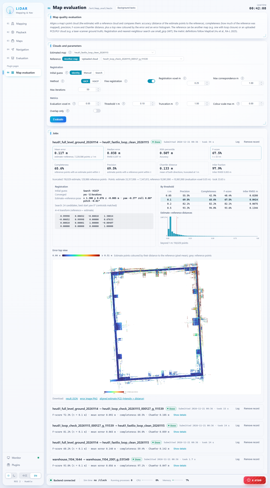

# SLAM and AutoNav Console

English | [中文](README.zh-CN.md)

[](https://leonhart999.github.io/slam-autonav-console/)
[](https://leonhart999.github.io/slam-autonav-console/console/)
[](https://github.com/Leonhart999/slam-console-plugins)
[](https://docs.ros.org/en/humble/)
[](LICENSE)

A browser-based console for **LiDAR SLAM mapping, rosbag2 playback, map cleanup, Nav2 navigation in Gazebo, batch runs, and `evo` evaluation** on ROS 2 Humble and Gazebo Fortress. If you already work with FAST-LIO2, GLIM, or Nav2 and want one workspace to run simulations, replay real-robot bags, inspect 2D/3D maps, and compare trajectories without juggling separate terminals and `rviz2` windows, this covers the workflow from raw scans to reproducible plots and CSVs.

Closed-loop Nav2 navigation runs in Gazebo Fortress (including scenes generated from saved 2D grids), while real-robot datasets run through rosbag2 playback, topic and extrinsics probing, offline loop optimization, and map post-processing. The interface supports **Chinese / English**, **light / dark / plugin-extensible themes** (with a bundled low-blue-light Eye-Care theme), and a **plugin system backed by an independently updated GitHub catalog** ([`Leonhart999/slam-console-plugins`](https://github.com/Leonhart999/slam-console-plugins)). Built for the bachelor thesis *LiDAR-Based SLAM Mapping and Autonomous Navigation for Mobile Robots* (Harbin Engineering University).

- **[Live warehouse replay](https://leonhart999.github.io/slam-autonav-console/)**: step through a recorded 230 m FAST-LIO2 mapping run in the simulated warehouse with live 3D point-cloud playback and APE metrics in your browser.
- **[Read-only console preview](https://leonhart999.github.io/slam-autonav-console/console/)**: click through the console pages, saved 2D/3D maps, Gazebo navigation runs, `evo` charts, and the plugin market catalog with no ROS 2 backend. The preview is static and read-only; launching stacks, saving maps, or installing plugins requires a local installation.

[](https://www.bilibili.com/video/BV1wm4v6GEQq)

*Video tour (2:19, [watch on Bilibili](https://www.bilibili.com/video/BV1wm4v6GEQq) or [download the MP4](https://github.com/Leonhart999/slam-autonav-console/releases/download/v0.1.0/slam-autonav-console_tour.mp4), 49 MB): mapping the office world with FAST-LIO2, saving the map, a three-waypoint Nav2 mission in the warehouse, and reviewing results on the Monitor and Evaluation pages. Captions in Chinese and English.*


## Table of Contents

- [Core Pages](#core-pages)
- [Feature Showcase & Real Examples](#feature-showcase--real-examples)
  - [1. Live 3D Mapping & Batch SLAM Experiments](#1-live-3d-mapping--batch-slam-experiments)
  - [2. Offline Planar Loop Optimization in the UI](#2-offline-planar-loop-optimization-in-the-ui)
  - [3. Map Post-Processing Plugins (DUFOMap & Patchwork++)](#3-map-post-processing-plugins-dufomap--patchwork)
  - [4. Multi-Session Alignment, Loop Diagnosis & 3D Map Evaluation](#4-multi-session-alignment-loop-diagnosis--3d-map-evaluation)
- [Plugin Ecosystem (Bundled + Market)](#plugin-ecosystem-bundled--market)
- [Typical Workflows](#typical-workflows)
- [How It Works](#how-it-works)
- [Quick Start](#quick-start)
- [Optional Parts & Configuration](#optional-parts--configuration)
- [Repository Layout](#repository-layout)
- [Limitations](#limitations)
- [Third-Party Components](#third-party-components)
- [Licence](#licence)

## Core Pages

| Page | Capabilities |
|---|---|
| **01 Mapping** | Launch built-in worlds (`office`, `warehouse`, optional `hkust_4f_west`) or your own uploaded SDF / ZIP scene; run **FAST-LIO2** (standard, **LiDAR-only**, and **ground-vehicle constraint** modes) or **GLIM**; inspect and override layered SLAM parameters in the **Parameters** dialog; watch the voxelized 3D map grow in real time; drive with an on-screen joystick / WASD or automated waypoint loop; save versioned 3D + 2D maps |
| **02 Playback** | Replay any rosbag2 bag (full bag or time slice, `0.5×–8×`) into FAST-LIO2, GLIM, or GLIM (LiDAR only); auto-probe real-robot topics, per-point timestamp fields/units, IMU acceleration units and extrinsics in **Sensor setup**; skip shaky starts (`start_offset`); record raw scans (**Save raw scans**) for downstream loop closure, dynamic removal and scan-evidence projection; upload and trash bags in the browser |
| **03 Maps** | Inspect saved maps (3D point cloud + 2D occupancy grid side by side); auto-project a navigable 2D grid when importing a cloud-only `.pcd`; regenerate 2D grids via cloud projection or **Scan evidence**; run **Loop optimization** directly from the page and preview before saving; edit grids with a brush; move to / restore from the recycle bin |
| **04 Navigation** | Load any saved map, launch Gazebo + Nav2 (**NavFn / Smac / Theta\*** planners × **DWB / MPPI** controllers, **AMCL** or **ground-truth localizer** switch), click initial pose and multi-waypoint goals on the 2D grid, overlay global/local costmaps, tune simulation speed, switch between point-cloud and solid world models, and bind or auto-generate a Gazebo world for maps built from real-robot bags |
| **05 Evaluation** | Separate records for **Mapping**, **Navigation**, and **Playback**; `evo` ATE / RPE metrics, per-goal navigation metrics, playback closure/height-drift/reference-odometry deviation and SLAM lag; **Side by side** or **Stacked** layouts; automated **Batch mapping** and **Batch navigation** experiments (mean ± std), user-override badges, relative trajectory comparison, CSV / PNG export |
| **Monitor** | Live status of console-managed process groups, topic publish rates vs. expected rates, TF tree chain, active ROS 2 nodes, and process exit reasons |
| **Plugins** | Unified **Installed / Plugin market** tabs: enable/disable plugins (takes effect on restart), auto-generated settings forms, per-plugin isolated Python virtual environments and background job queues, one-click install/update from [`Leonhart999/slam-console-plugins`](https://github.com/Leonhart999/slam-console-plugins) (SHA-256 verified) or local `.zip` upload; market updates cleanly shadow bundled copies |
| **Settings** | Centralized browser preferences and machine overrides (`/settings`): **General** (language, theme / follow system / plugin themes, density, UI scale, reduced motion, start page, task-completion notifications), **Data & storage** (data folder paths, size breakdown, config export/import/reset), **Experiment defaults** (`evo` tolerances, batch timeouts, nav & playback defaults), **Teleop & safety** (velocity limits, watchdog, E-stop zero-velocity hold), **Network & connection** (port, GitHub/pip proxies with connectivity test), and **About** (release update check and runtime diagnostics) |

Long-running operations (2D regridding, offline loop optimization, `evo` evaluation, relative trajectory comparison, report export) run through the header **Background tasks** drawer so progress survives page switches and reloads, and finished jobs can be inspected, retried, removed, or cleared.

Every run leaves a self-contained record (`est.tum`, `gt.tum` / `ref.tum`, `slam_config`, lag logs, or navigation goal CSVs + plots), and every saved map is a portable folder containing the 3D cloud, Nav2 `map.yaml` / `map.pgm`, preview figures, and metadata.

## Feature Showcase & Real Examples

### 1. Live 3D Mapping & Batch SLAM Experiments

In **Mapping**, voxel deltas stream over binary WebSocket so large accumulated maps render smoothly in the browser. In **Evaluation**, batch mapping and navigation experiments repeat the same route automatically and aggregate ATE/RPE or navigation metrics as `mean ± std` (for example, `office` N = 5 FAST-LIO2 ATE `0.0305 ± 0.0012 m`, `warehouse` N = 3 ATE `0.0346 ± 0.0011 m`, GLIM warehouse `0.0149 m`).

<p>
  
  
</p>

### 2. Offline Planar Loop Optimization in the UI

For maps recorded with **Save raw scans**, clicking **Loop optimization** on the **Maps** page runs the offline planar pose-graph back-end (`GTSAM` + `small_gicp`) as a background task, displays verified loop candidates and before/after wall alignment figures, and lets you save an optimized derived map without modifying the original. In the real-robot 611 m corridor loop shown below, horizontal endpoint drift of `2.52 m` (`-1.05°` heading) is closed, cutting revisit wall median error from `42.2 cm` down to `6.4 cm` (`p90: 243.3 → 15.5 cm`).


### 3. Map Post-Processing Plugins (DUFOMap & Patchwork++)

Two bundled tool plugins clean real-robot maps directly from the browser and save non-destructive derived map versions via `POST /api/maps/{name}/derive`:

- **Dynamic object removal (`dynamic_removal`)**: uses DUFOMap over raw scans to remove moving pedestrians and vehicles (below left: `1,422` scans on M3DGR `Occlusion01`, `2.9 s`, flagging `0.48%` ghost points).
- **Ground segmentation (`ground_seg`)**: uses Patchwork++ to separate local ground from obstacles and rebuild the 2D occupancy grid by height above local ground — rescuing tilted or height-drifting maps (below right: M3DGR tilted floor restored to a clean navigable grid in `2.3 s`).

<p>
  
  
</p>

### 4. Multi-Session Alignment, Loop Diagnosis & 3D Map Evaluation

Market plugins install into isolated Python virtual environments from **Plugins → Plugin market**:

- **Map alignment & merge (`map_merge`, KISS-Matcher + `small_gicp`)**: aligns two 3D maps from arbitrary frames with no initial guess, refines 6-DoF alignment, previews overlap, and exports a merged map (below: recovers a `135°` + `[24.7, -3.6, -1.9] m` warehouse transform in `1.3 s`, overlap `6.6% → 98.5%`, RMSE `0.116 m`).
- **Map quality evaluation (`map_eval`, `small_gicp` / MapEval)** & **Loop closure check (`loop_closures`, MapClosures + KISS-ICP)**: evaluate 3D point-cloud accuracy/completeness/F-score/Chamfer distance against a reference map, or audit odometry drift at revisited loops without ground truth.


<details>
<summary>More plugin screenshots: Map quality evaluation (<code>map_eval</code>) &amp; Loop closure check (<code>loop_closures</code>)</summary>

<p>
  
  
</p>

</details>

## Plugin Ecosystem (Bundled + Market)

All plugins share the same **Plugin Interface v1** (`plugin.yaml`, `/api/ext/<id>`, `window.RobotConsole` SDK, isolated Python venvs, default-disabled trust model). Core plugins ship bundled with the console for offline availability **and** are listed in the public market index [`Leonhart999/slam-console-plugins`](https://github.com/Leonhart999/slam-console-plugins) so every plugin is visible in one catalog and can be updated independently without reinstalling the console:

| Plugin | Distribution | Powered by | What it does |
|---|---|---|---|
| **`ai_assistant`** AI assistant (`0.6.0`) | Bundled + Market | OpenAI-compatible / Anthropic APIs, embedded CPA OAuth engine | Freely resizable header chat drawer with glass (liquid glass / busy edge glow) and classic skins plus in-panel settings, searchable SQLite history, token & cost usage charts (with price table sync from `models.dev`), OAuth subscription sign-in, read-only console inspection tools, and approval-gated batch/evaluation run tools |
| **`bag_convert`** Bag converter | Bundled + Market | [rosbags](https://gitlab.com/ternaris/rosbags) (Apache-2.0) | Converts ROS 1 `.bag` files to ROS 2 (`sqlite3` / `MCAP`) with topic selection and Livox `CustomMsg` → `PointCloud2` conversion |
| **`dynamic_removal`** Dynamic object removal | Bundled + Market | [DUFOMap](https://github.com/KTH-RPL/dufomap) (BSD-3) | Removes moving-object ghost points using raw-scan free-space visibility and derives a cleaned map version |
| **`ground_seg`** Ground segmentation | Bundled + Market | [Patchwork++](https://github.com/url-kaist/patchwork-plusplus) (BSD-2) | Segments local ground vs. non-ground points and rebuilds the Nav2 2D occupancy grid by local height |
| **`eye_care_ui`** Eye-care UI | Bundled + Market | Plugin Theme API v1 | Adds a warm amber low-blue-light appearance mode with a header toggle and live filter strength / warmth / contrast controls |
| **`map_eval`** Map quality evaluation | Market | [small_gicp](https://github.com/koide3/small_gicp) (MIT) | Registers an estimated map against a reference cloud (map or PCD/PLY) and computes MapEval accuracy, completeness, precision, F-score, Chamfer distance, histogram and error map |
| **`loop_closures`** Loop closure check | Market | [MapClosures](https://github.com/PRBonn/MapClosures) + [KISS-ICP](https://github.com/PRBonn/kiss-icp) (MIT) | Detects revisited places in raw-scan maps and measures planar/height/heading odometry drift without ground truth |
| **`map_merge`** Map alignment & merge | Market | [KISS-Matcher](https://github.com/MIT-SPARK/KISS-Matcher) + [small_gicp](https://github.com/koide3/small_gicp) (MIT) | Global 6-DoF alignment of two 3D maps with no initial guess, GICP/VGICP refinement, overlap preview and voxel-merged map export |

Want to build your own plugin? See [robot_console/docs/plugins.md](robot_console/docs/plugins.md), [robot_console/docs/plugin-guidelines.md](robot_console/docs/plugin-guidelines.md), `robot_console/examples/plugins/hello_console`, and [`CONTRIBUTING.md`](https://github.com/Leonhart999/slam-console-plugins/blob/main/CONTRIBUTING.md) in the market repository.

## Typical Workflows

<details>
<summary><strong>Workflow A: Simulation Mapping → Navigation → Batch Benchmark</strong></summary>

1. Open **Mapping**, pick `office` or `warehouse`, start **Simulation**, start **FAST-LIO2** (or **GLIM**), and run the **Waypoints** route (or drive via WASD / joystick).
2. Click **Save map** to store the 3D point cloud, 2D Nav2 grid, trajectories, and metadata.
3. Open **Navigation**, select the saved map, choose a planner/controller variant (e.g. `navfn_dwb` or `smac_mppi`) and localizer (`AMCL` or `Ground truth`), start Simulation + Navigation, and send single or multi-waypoint goals.
4. Open **Evaluation** to inspect ATE/RPE, AMCL error curves, or launch automated **Batch mapping** / **Batch navigation** trials and export CSV + PNG figures.

</details>

<details>
<summary><strong>Workflow B: Real-Robot Dataset → Cleaning / Loop Closure → Virtual Navigation</strong></summary>

1. If your dataset is a ROS 1 `.bag` (including Livox `CustomMsg`), enable **Bag converter** on the **Plugins** page to convert it to a ROS 2 bag; per-frame PCD sequences can be converted with `robot_console/tools/pcd_frames_to_bag.py`.
2. Open **Playback**, pick the bag, run **Sensor setup** to auto-detect topics, point-time fields, IMU units and extrinsics, toggle **Save raw scans** (and **Ground-vehicle constraint** for wheeled robots), and play the bag at `1×–4×` into FAST-LIO2.
3. Save the map, then open **Maps**: run **Loop optimization** to close planar drift, or use the **Dynamic object removal** and **Ground segmentation** plugins to clean pedestrians and tilted floors into a derived map version.
4. Open **Navigation** with the cleaned map, generate a Gazebo wall world from its 2D grid, and test Nav2 routes on your real-world layout.

</details>

## How It Works

```text
Browser (Vue 3, Three.js, ECharts)  <-- HTTP + WebSocket, 127.0.0.1:8000 -->  robot_console (rclpy + FastAPI)
                                                                                 |  ROS 2 topics, services, actions
                                                     Gazebo Fortress  /  FAST-LIO2 or GLIM  /  Nav2 + AMCL  /  evo
                                                                                 |  ctx.api / ctx.jobs / isolated venvs
                                                                       Bundled & Market Plugins (Interface v1)
```

- **Whitelisted process management**: the backend starts simulation, SLAM, playback, and navigation as separate process groups from `robot_console/config/stacks.yaml`; the browser can only request named stacks, never arbitrary shell commands.
- **Layered SLAM parameters**: each run synthesizes its effective config in layers (`base → input → derived → options → console → user` from `robot_console/config/slam/`) and archives it into `run.json` for reproducible comparisons.
- **High-FPS 3D web streaming**: point clouds are voxelized in the backend and streamed as compact binary deltas, keeping browser rendering smooth even where `rviz2` under WSLg drops to ~3 fps.
- **Safety interlocks**: teleoperation halts the robot after `0.5 s` without commands or on WebSocket disconnect; **E-STOP** publishes zero velocity, cancels Nav2 goals, and terminates all driving processes.

## Quick Start

Requirements: Ubuntu 22.04 `x86_64` (native or WSL2 on Windows 10/11), a normal user with `sudo`, 16 GB RAM recommended, ~10 GB free disk.

```bash
mkdir -p ~/ros2_ws/src && cd ~/ros2_ws/src
git clone https://github.com/Leonhart999/slam-autonav-console.git
bash slam-autonav-console/robot_console/install/install.sh          # add --cn for mirrors in mainland China
bash slam-autonav-console/robot_console/install/start_console.sh    # starts the console, opens http://localhost:8000
```

The installer sets up ROS 2 Humble, Gazebo Fortress, Nav2, Livox-SDK2, FAST-LIO2 (pinned commit plus a small patch), the Python environments (`console` and `evo`), and the web frontend, then runs a self-check. Completed steps are skipped automatically, so re-running after a transient network failure resumes cleanly. See [robot_console/README.md](robot_console/README.md) for installer flags and offline setup.

Alternatively, run the stack in Docker:

```bash
docker compose build          # add CN=1 in mainland China
docker compose up -d
```

See [docker/README.md](docker/README.md) for details (tested on WSL2 + Docker Engine; the Navigation page has not yet been tested inside the container).

## Optional Parts & Configuration

- **GLIM** (factor-graph SLAM with loop closure): install `ros-humble-glim-ros` from the author's PPA (<https://koide3.github.io/glim/installation.html>). Base configs for the simulated 16-line LiDAR live in `sim_robot/config/glim`, with layered overrides in `robot_console/config/slam/glim.yaml`.
- **HKUST 4F west world** (long corridors, built from the BIM of [SLABIM](https://github.com/HKUST-Aerial-Robotics/SLABIM)): only `BIM.zip` (96 MB) is needed. The SharePoint links in the SLABIM README are no longer accessible; download from Hugging Face instead (mainland China mirror: `https://hf-mirror.com/datasets/BobH62/SLABIM/resolve/main/BIM.zip`):

  ```bash
  wget https://huggingface.co/datasets/BobH62/SLABIM/resolve/main/BIM.zip
  python3 -m zipfile -e BIM.zip SLABIM        # gives SLABIM/BIM/4F/mesh/*.ply
  bash sim_robot/tools/make_hkust_models.sh SLABIM
  colcon build --packages-select sim_robot
  ```

- **Offline planar loop back-end environment**: to enable **Loop optimization** on the **Maps** page (and the CLI tools `fastlio_loop_record`, `fastlio_loop`, `fastlio_loop_export`), install `robot_console/install/requirements-loop.txt` into a separate Python venv (default `~/venvs/loop`) so system GLIM / GTSAM stays untouched. See [robot_console/docs/fastlio-loop-backend.md](robot_console/docs/fastlio-loop-backend.md).
- **Machine-specific configuration**: edit data folders, experiment defaults, teleop limits, and proxies directly from the **Settings** button at the bottom of the sidebar (atomically writes `~/.config/robot_console/console.yaml` with comment preservation and rotating backups), or edit the file manually (template: `robot_console/config/user_console.example.yaml`). Maps, run records, logs, bags, sensor profiles, plugin data/venvs, and exports live under `~/robot_console_data` by default.

## Repository Layout

| Folder | ROS 2 package | Contents |
|---|---|---|
| `robot_console/` | `robot_console` | Console backend (FastAPI + rclpy), web frontend (`web/`), plugin host + market + bundled plugins (`plugins/`), layered SLAM specs, loop back-end, installer, tests |
| `sim_robot/` | `sim_robot` | Gazebo worlds, diff-drive robot (16-line LiDAR, IMU, ground truth), cloud adapter, waypoint driver, FAST-LIO2 / GLIM configs |
| `lidar_nav/` | `lidar_nav` | Nav2 launch and planner/controller parameter variants, ground-truth localizer, 3D → 2D grid projection, navigation test tools |
| `docker/` | — | Dockerfile, entrypoint, container configuration, and offline prefetch guide |

## Limitations

- **Simulation-first closed loop**: navigation runs closed-loop in Gazebo; driving a physical robot requires its own hardware stacks and topic mappings. Real-robot datasets can be mapped on **Playback** (`sqlite3` storage; MCAP requires `ros-humble-rosbag2-storage-mcap`) and tested in a Gazebo world generated from the saved map.
- **Sensor profiles**: browser-created sensor profiles configure FAST-LIO2 and IMU-enabled GLIM (`GLIM (LiDAR only)` does not yet route through the sensor adapter). Scan-end-stamped LiDARs with negative per-point offsets (e.g. some Velodyne bags) are flagged during probing and clamped to `0` by the adapter.
- **Planar loop back-end assumption**: assumes an approximately horizontal single-floor environment and requires raw scans recorded during playback.
- **Other**: no standalone offline trajectory import yet; tested on Ubuntu 22.04 + ROS 2 Humble (`x86_64`) only; saving a GLIM map stops the GLIM process because GLIM exports its optimized map on exit.

## Third-Party Components

| Component | Licence | How it gets onto your machine |
|---|---|---|
| [FAST_LIO](https://github.com/hku-mars/FAST_LIO), ikd-Tree | GPL-2.0 | Downloaded by the installer; `robot_console/install/patches/fast_lio-thesis.patch` switches cloud subscription to reliable QoS and adds LiDAR-only mode, ground-vehicle constraint, ring bounds check and deeper IMU queue |
| Livox-SDK2, livox_ros_driver2 | MIT | Downloaded by the installer |
| Warehouse, shelf, pallet and cart models (Gazebo Fuel; OpenRobotics, MovAi) | CC BY-NC 4.0 / CC BY-NC-ND 4.0 | Downloaded by `sim_robot/tools/fetch_fuel_models.sh`; non-commercial use only. The online demo renders only the mapped point cloud, not the models |
| HKUST 4F building model (SLABIM, Huang et al., ICRA 2025) | Not stated by dataset | Built locally from your own SLABIM download; not included in this repo |
| [GLIM](https://github.com/koide3/glim) | MIT | Optional, installed from the author's PPA |
| [evo](https://github.com/MichaelGrupp/evo) | GPL-3.0 | Installed into its own virtual environment by the installer |
| Bundled & market plugin upstreams (`rosbags`, `Patchwork++`, `DUFOMap`, `small_gicp`, `MapClosures`, `KISS-ICP`, `KISS-Matcher`) | Apache-2.0 / BSD-2 / BSD-3 / MIT | Installed on demand into per-plugin isolated virtual environments from the **Plugins** page |

## Licence

The code in this repository is released under the MIT licence (see [LICENSE](LICENSE)).
