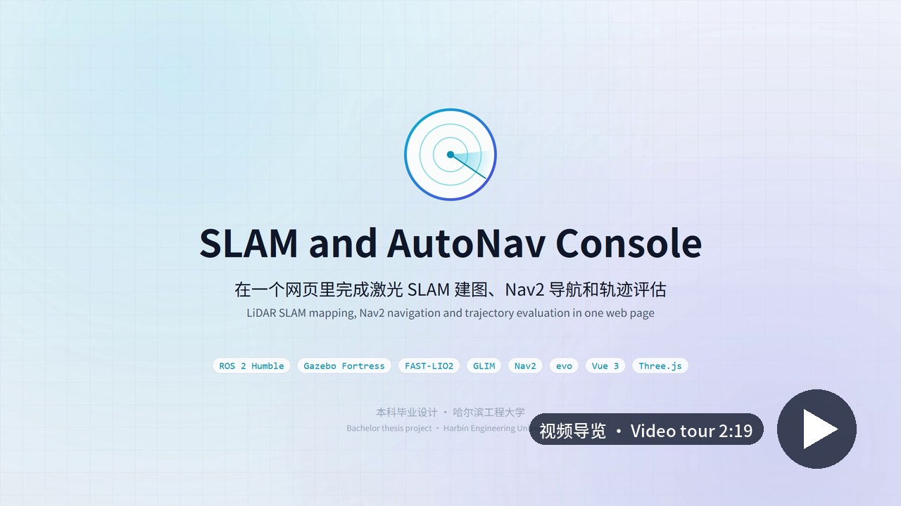
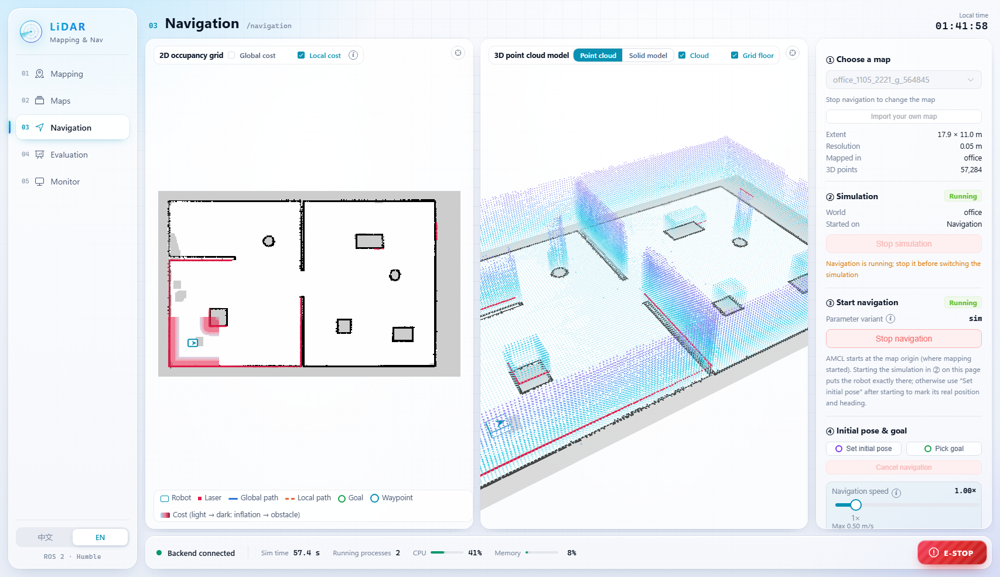
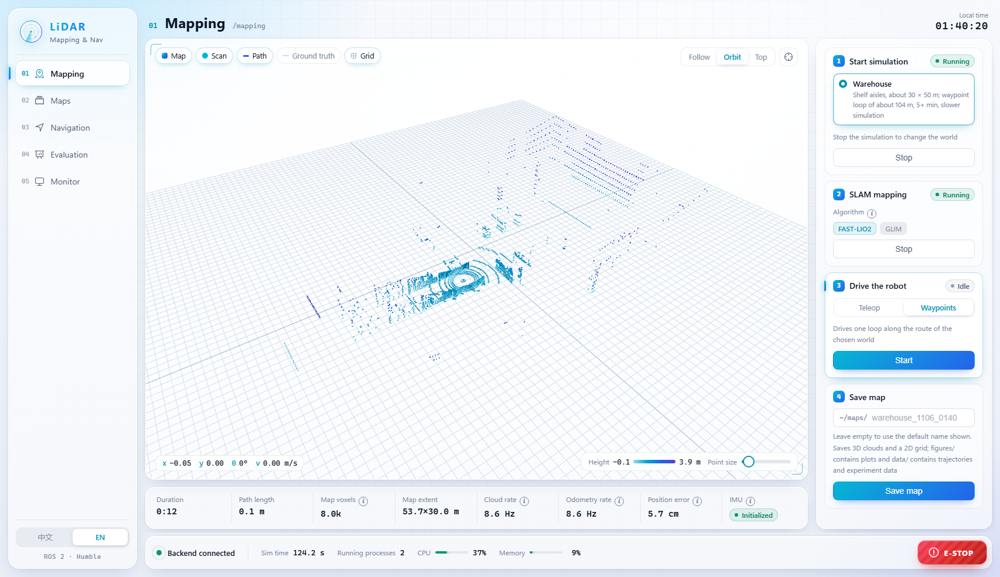
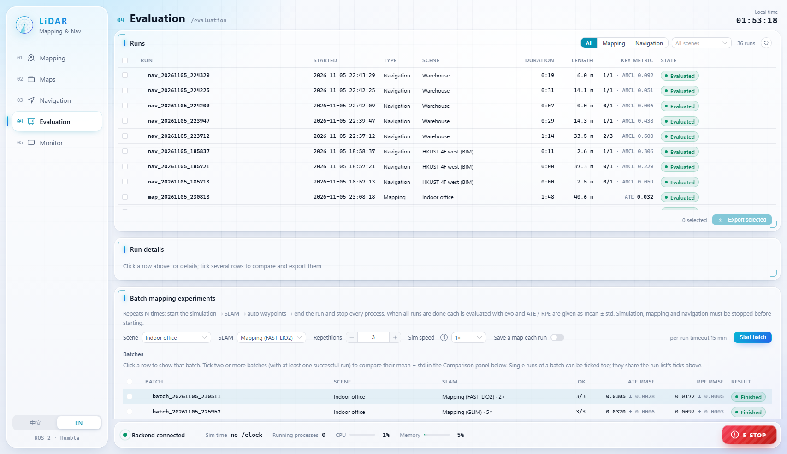

# SLAM and AutoNav Console

English | [中文](README.zh-CN.md)

A browser console for LiDAR SLAM mapping, map management, Nav2 autonomous navigation and trajectory
evaluation, running on ROS 2 Humble with a Gazebo Fortress simulation. One page takes you from an empty
world to a saved map, a navigation run and an evo report.

It was built for the bachelor thesis *LiDAR-Based SLAM Mapping and Autonomous Navigation for Mobile
Robots* (Harbin Engineering University). The interface is bilingual (中文 / English).

[](https://www.bilibili.com/video/BV1wm4v6GEQq)

*Video tour (2:19, [watch on Bilibili](https://www.bilibili.com/video/BV1wm4v6GEQq) or [download the MP4](https://github.com/Leonhart999/slam-autonav-console/releases/download/v0.1.0/slam-autonav-console_tour.mp4), 49 MB): mapping the office world with FAST-LIO2, saving the map, a three-waypoint Nav2
mission in the warehouse, the monitor and evaluation pages. Captions in Chinese and English.*



## Features

| Page | What it does |
|---|---|
| **Mapping** | Start a world (office, warehouse, or your own uploaded SDF / ZIP), run FAST-LIO2 or GLIM, watch the voxel map grow in a 3D view, drive with an on-screen joystick / WASD or a waypoint route, save the map |
| **Playback** | Play a rosbag2 bag (or a chosen part of it, 0.5–8x) into FAST-LIO2, GLIM or GLIM (LiDAR only) and save the map like a live run; upload bags from the browser, delete them to a trash. `robot_console/tools/pcd_frames_to_bag.py` turns per-frame PCD exports into a bag |
| **Maps** | Browse saved maps (3D point cloud + 2D grid side by side), regenerate the 2D grid from the cloud with other parameters, edit the grid with a brush, import maps, trash and restore |
| **Navigation** | Load a map, start the simulation and Nav2, set the initial pose and goals on the map, run multi-waypoint missions, overlay global / local costmaps, change the speed factor, switch between point cloud and solid world model. A map built from a bag gets a simulation world either by linking the world the bag was recorded in or by generating one from its own occupancy grid |
| **Evaluation** | ATE / RPE of mapping runs with evo, navigation metrics (success rate, time, path length, goal error, AMCL error, clearance), comparisons, repeated batch experiments with mean ± std, CSV / PNG export |
| **Monitor** | Processes started from the console, topic rates against expected rates, TF chain, node list, how each process was stopped |

Every run is recorded: mapping runs keep the estimated and ground-truth trajectories, navigation runs keep
per-goal results, the AMCL error over time and figures. A saved map is a folder with the full point cloud,
a Nav2 `map.yaml` / `map.pgm`, figures and metadata.

<p>
  
  
</p>

## How it works

```
Browser (Vue 3, Three.js, ECharts)  <-- HTTP + WebSocket, 127.0.0.1:8000 -->  robot_console (rclpy + FastAPI)
                                                                                 |  ROS 2 topics, services, actions
                                                     Gazebo Fortress  /  FAST-LIO2 or GLIM  /  Nav2 + AMCL  /  evo
```

- The backend starts the simulation, SLAM and navigation as separate process groups from a whitelist
  (`robot_console/config/stacks.yaml`); the page can only name a stack, never pass a command line.
- Point clouds are voxelized in the backend and streamed as binary deltas, so the browser draws a large
  map at full frame rate (rviz2 under WSLg managed about 3 fps with the accumulated map).
- Teleoperation stops the robot after 0.5 s without commands and when the page disconnects; E-STOP sends
  zero velocity, cancels Nav2 goals and stops the processes that drive the robot.

## Quick start

Requirements: Ubuntu 22.04 x86_64 (native or WSL2 on Windows 10/11), a normal user with `sudo`, 16 GB RAM
recommended, about 10 GB free disk.

```bash
mkdir -p ~/ros2_ws/src && cd ~/ros2_ws/src
git clone https://github.com/Leonhart999/slam-autonav-console.git
bash slam-autonav-console/robot_console/install/install.sh          # add --cn for mirrors in mainland China
bash slam-autonav-console/robot_console/install/start_console.sh    # starts the console, opens http://localhost:8000
```

The installer sets up ROS 2 Humble, Gazebo Fortress, Nav2, Livox-SDK2, FAST-LIO2 (pinned commit plus a
small patch), two Python environments (console and evo) and the web frontend, then runs a self-check. It
skips steps that are already done, so it can simply be run again after a failure. Options, offline
installation and configuration are described in [robot_console/README.md](robot_console/README.md).

First run: on the **Mapping** page pick the office world, start the simulation, start FAST-LIO2, press
*Start* under waypoints and save the map when the loop is done. Then pick the map on the **Navigation**
page, start the simulation and navigation there, and click a goal on the 2D grid.

### Optional parts

- **GLIM** (factor-graph SLAM with loop closure): install `ros-humble-glim-ros` from the author's PPA, see
  <https://koide3.github.io/glim/installation.html>. The configuration for the simulated 16-line lidar is in
  `sim_robot/config/glim`.
- **HKUST 4F west world** (long corridors, built from the SLABIM BIM): download the
  [SLABIM dataset](https://github.com/HKUST-Aerial-Robotics/SLABIM), then
  `bash sim_robot/tools/make_hkust_models.sh /path/to/SLABIM` and
  `colcon build --packages-select sim_robot`. The scene appears on the Mapping page afterwards.

### Configuration

Machine-specific settings go in `~/.config/robot_console/console.yaml`; only the keys you change are needed
(example: `robot_console/config/user_console.example.yaml`). Maps, run records, logs and exports live
under `~/robot_console_data` by default.

## Repository layout

| Folder | ROS 2 package | Contents |
|---|---|---|
| `robot_console/` | `robot_console` | the console: backend, frontend (`web/`), configuration, installer, tests |
| `sim_robot/` | `sim_robot` | Gazebo worlds, the diff-drive robot (16-line lidar, IMU, ground truth), cloud adapter, waypoint driver, FAST-LIO2 / GLIM configuration |
| `lidar_nav/` | `lidar_nav` | Nav2 launch and parameter variants, 3D → 2D map projection, navigation test tools |

## Limitations

- Simulation first: navigation runs closed-loop in Gazebo, and driving a real robot would need its own
  stacks and topic configuration. Real-robot data can be mapped from a bag on the Playback page (sqlite3
  storage; MCAP needs `ros-humble-rosbag2-storage-mcap`) and navigated in a world generated from the map,
  where the simulated lidar sees ideal walls.
- No offline trajectory import yet.
- Tested on Ubuntu 22.04 + ROS 2 Humble (x86_64) only.
- Saving a map with GLIM stops the GLIM run, because GLIM writes its optimized map on exit.

## Third-party components

| Component | Licence | How it gets onto your machine |
|---|---|---|
| [FAST_LIO](https://github.com/hku-mars/FAST_LIO), ikd-Tree | GPL-2.0 | downloaded by the installer; `robot_console/install/patches/fast_lio-thesis.patch` switches the cloud subscription to reliable QoS |
| Livox-SDK2, livox_ros_driver2 | MIT | downloaded by the installer |
| Warehouse, shelf, pallet and cart models (Gazebo Fuel; OpenRobotics, MovAi) | CC BY-NC 4.0 / CC BY-NC-ND 4.0 | downloaded by `sim_robot/tools/fetch_fuel_models.sh`; non-commercial use only |
| HKUST 4F building model (SLABIM, Huang et al., ICRA 2025) | not stated by the dataset | built from your own SLABIM download; not included |
| [GLIM](https://github.com/koide3/glim) | MIT | optional, installed from the author's PPA |
| [evo](https://github.com/MichaelGrupp/evo) | GPL-3.0 | installed into its own virtual environment by the installer |

## Licence

The code in this repository is released under the MIT licence (see [LICENSE](LICENSE)).
