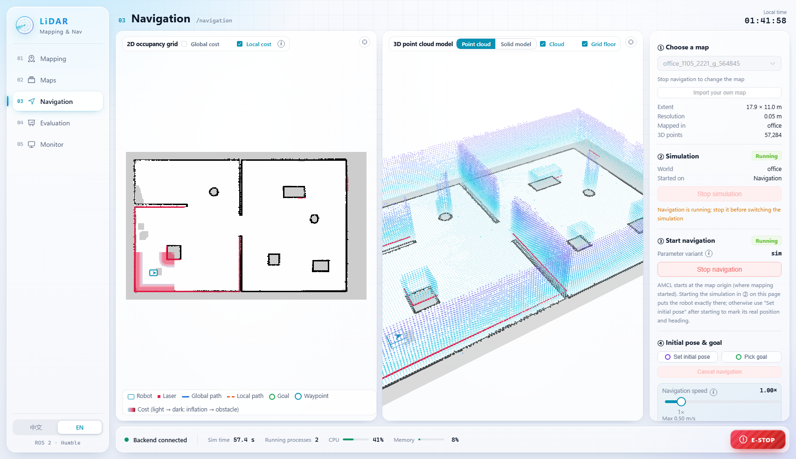
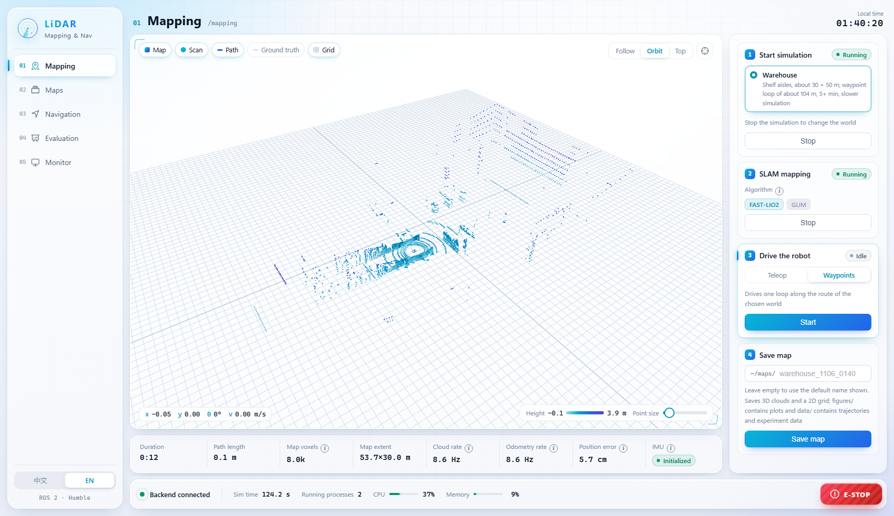
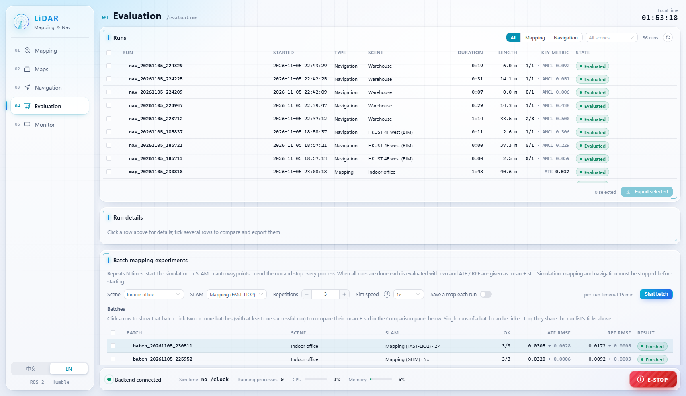

# SLAM and AutoNav Console

[English](README.md) | 中文

LiDAR SLAM 建图和自主导航控制台，覆盖LiDAR SLAM 建图、地图管理、Nav2 自主导航、全流程自动化实验和轨迹评估，在 ROS 2 Humble 中和 Gazebo Fortress 仿真上运行。
从一个建模场景开始，在同一个网页里就能完成建图、存图、导航，最后用 evo 出评估结果。

本项目是哈尔滨工程大学本科毕业设计 *LiDAR-Based SLAM Mapping and Autonomous Navigation for Mobile Robots* 的配套软件。界面支持中文和英文。

[](https://www.bilibili.com/video/BV1wm4v6GEQq)

*视频导览（2:19，[在 B 站观看](https://www.bilibili.com/video/BV1wm4v6GEQq)，或[下载 MP4](https://github.com/Leonhart999/slam-autonav-console/releases/download/v0.1.0/slam-autonav-console_tour.mp4)，49 MB）：在办公室场景用 FAST-LIO2 建图并保存，在仓库场景执行三个航点的 Nav2任务，再看系统监控页和实验评估页。*



## 功能

| 页面 | 能做什么 |
|---|---|
| **建图** | 启动场景（办公室、仓库，或自己上传的 SDF / ZIP），运行 FAST-LIO2 或 GLIM，在 3D 视图里看体素地图实时增长；用屏幕摇杆 / WASD 遥控，或按航点路线自动行驶；保存地图 |
| **地图管理** | 浏览已保存的地图（3D 点云和 2D 栅格并排显示），换一组参数从点云重新生成 2D 栅格，用画笔编辑栅格，导入地图，删除到回收站和恢复 |
| **导航** | 载入地图，启动仿真和 Nav2，在地图上设初始位姿和目标点，执行多航点任务，叠加全局 / 局部代价地图，调整导航倍速，在点云模型和实体模型之间切换 |
| **实验评估** | 用 evo 计算建图运行的 ATE / RPE；导航指标（成功率、用时、路径长度、到达误差、AMCL 误差、与障碍的最小距离）；多条记录对比；批量重复实验，给出均值 ± 标准差；导出 CSV / PNG |
| **系统监控** | 从控制台启动的进程、各话题的实际频率与期望频率、TF 链、节点列表、每个进程是怎么停止的 |

每次运行都会留下记录：建图运行保存估计轨迹和真值轨迹，导航运行保存每个目标点的结果、AMCL 误差随时间的变化和图表。
保存的地图是一个文件夹，里面有完整点云、Nav2 用的 `map.yaml` / `map.pgm`、图片和元数据。

<p>
  
  
</p>

## 工作原理

```
浏览器（Vue 3、Three.js、ECharts）  <-- HTTP + WebSocket，127.0.0.1:8000 -->  robot_console（rclpy + FastAPI）
                                                                                 |  ROS 2 话题、服务、动作
                                                     Gazebo Fortress  /  FAST-LIO2 或 GLIM  /  Nav2 + AMCL  /  evo
```

- 后端按白名单（`robot_console/config/stacks.yaml`）把仿真、SLAM 和导航分别作为独立的进程组启动。网页只能指定白名单里的名字，不能传命令行。
- 点云在后端做体素化，再以二进制增量推给网页，所以浏览器能流畅地画出大地图（同样的累积地图在 WSLg 下的 rviz2 里只有约 3 fps）。
- 遥控时 0.5 s 收不到指令，或网页断开连接，小车都会停下。急停会发零速度、取消 Nav2 目标，并停止所有会驱动小车的进程。

## 快速开始

环境要求：Ubuntu 22.04 x86_64（原生系统，或 Windows 10/11 上的 WSL2），有 `sudo` 权限的普通用户，建议 16 GB 内存，约 10 GB 空闲磁盘。

```bash
mkdir -p ~/ros2_ws/src && cd ~/ros2_ws/src
git clone https://github.com/Leonhart999/slam-autonav-console.git
bash slam-autonav-console/robot_console/install/install.sh          # 在中国大陆可加 --cn 使用国内镜像
bash slam-autonav-console/robot_console/install/start_console.sh    # 启动控制台并打开 http://localhost:8000
```

安装脚本会装好 ROS 2 Humble、Gazebo Fortress、Nav2、Livox-SDK2、FAST-LIO2（固定版本加一个小补丁）、两个 Python
环境（控制台和 evo）以及网页前端，最后做一次自检。已经完成的步骤会跳过，所以中途失败后直接重新运行即可。
安装选项、离线安装和配置说明见 [robot_console/README.md](robot_console/README.md)（英文）。

第一次使用：在**建图**页选办公室场景，启动仿真，启动 FAST-LIO2，在“移动小车”里选“自动航点”并点*启动*，跑完一圈后保存地图。
然后在**导航**页选这张地图，在那里启动仿真和导航，在 2D 栅格上点一个目标点。

### 可选部分

- **GLIM**（带回环的因子图 SLAM）：从作者的 PPA 安装 `ros-humble-glim-ros`，见
  <https://koide3.github.io/glim/installation.html>。针对仿真 16 线激光雷达的配置在 `sim_robot/config/glim`。
- **港科大 4 楼西侧场景**（长走廊，由 SLABIM 的 BIM 模型生成）：先下载
  [SLABIM 数据集](https://github.com/HKUST-Aerial-Robotics/SLABIM)，然后运行
  `bash sim_robot/tools/make_hkust_models.sh /path/to/SLABIM` 和 `colcon build --packages-select sim_robot`，
  建图页就会出现这个场景。

### 配置

本机相关的设置写在 `~/.config/robot_console/console.yaml`，只需写要改的项（示例见
`robot_console/config/user_console.example.yaml`）。地图、运行记录、日志和导出结果默认放在 `~/robot_console_data`。

## 仓库结构

| 目录 | ROS 2 包 | 内容 |
|---|---|---|
| `robot_console/` | `robot_console` | 控制台本体：后端、前端（`web/`）、配置、安装脚本、测试 |
| `sim_robot/` | `sim_robot` | Gazebo 场景、差速小车（16 线激光雷达、IMU、真值）、点云适配、航点驱动、FAST-LIO2 / GLIM 配置 |
| `lidar_nav/` | `lidar_nav` | Nav2 启动文件和参数变体、3D → 2D 地图投影、导航测试工具 |

## 局限

- 只支持仿真：建图页和导航页都要求有一个带真值的 Gazebo 场景在运行。接真实机器人需要另写进程配置和话题配置。
- 还不能回放 rosbag，也不能导入离线轨迹。
- 只在 Ubuntu 22.04 + ROS 2 Humble（x86_64）上测试过。
- 用 GLIM 时保存地图会结束这次 GLIM 运行，因为 GLIM 只在退出时写出优化后的地图。

## 第三方组件

| 组件 | 许可证 | 获取方式 |
|---|---|---|
| [FAST_LIO](https://github.com/hku-mars/FAST_LIO)、ikd-Tree | GPL-2.0 | 安装脚本下载；`robot_console/install/patches/fast_lio-thesis.patch` 把点云订阅改为 reliable QoS |
| Livox-SDK2、livox_ros_driver2 | MIT | 安装脚本下载 |
| 仓库、货架、托盘和推车模型（Gazebo Fuel；OpenRobotics、MovAi） | CC BY-NC 4.0 / CC BY-NC-ND 4.0 | 由 `sim_robot/tools/fetch_fuel_models.sh` 下载；仅限非商业用途 |
| 港科大 4 楼建筑模型（SLABIM，Huang 等，ICRA 2025） | 数据集未注明 | 用你自己下载的 SLABIM 生成，仓库里不包含 |
| [GLIM](https://github.com/koide3/glim) | MIT | 可选，从作者的 PPA 安装 |
| [evo](https://github.com/MichaelGrupp/evo) | GPL-3.0 | 安装脚本装进单独的虚拟环境 |

## 许可证

本仓库的代码以 MIT 许可证发布（见 [LICENSE](LICENSE)）。
