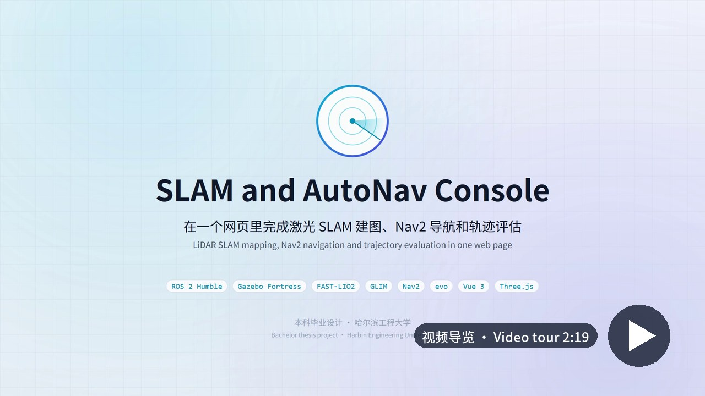
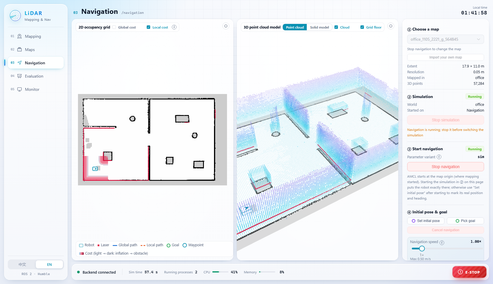
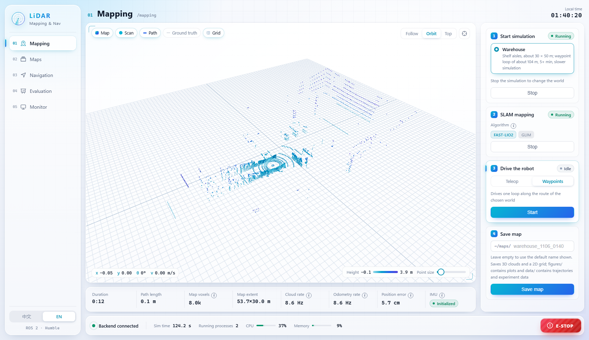
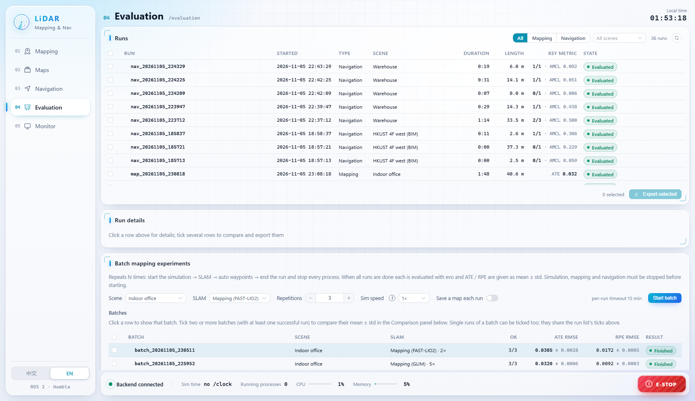
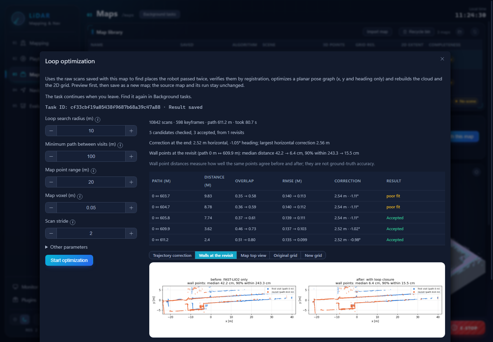
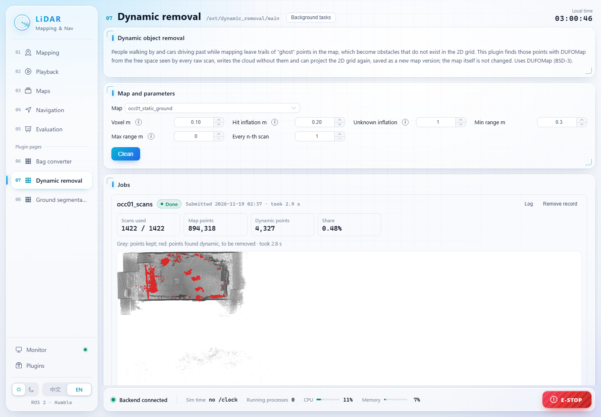
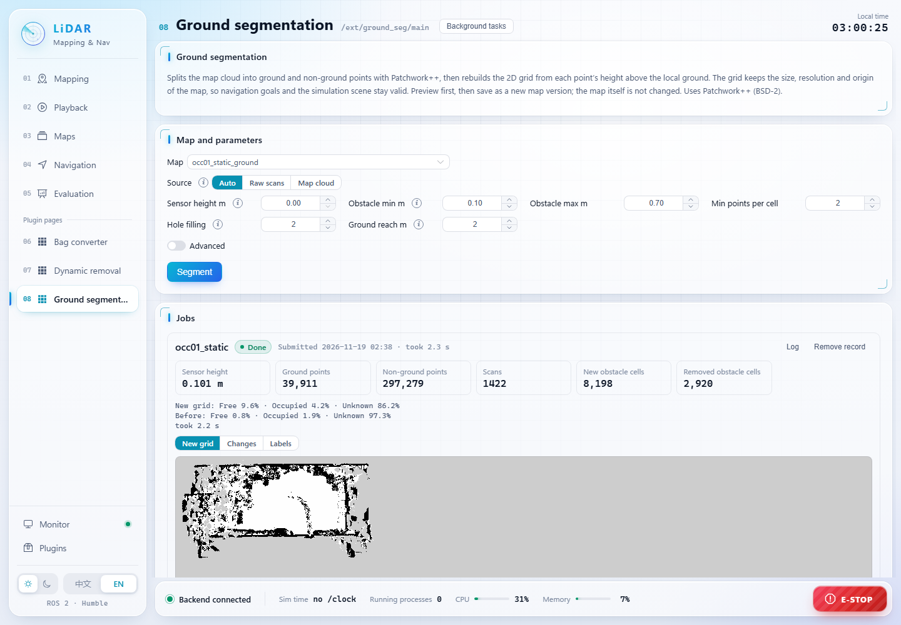
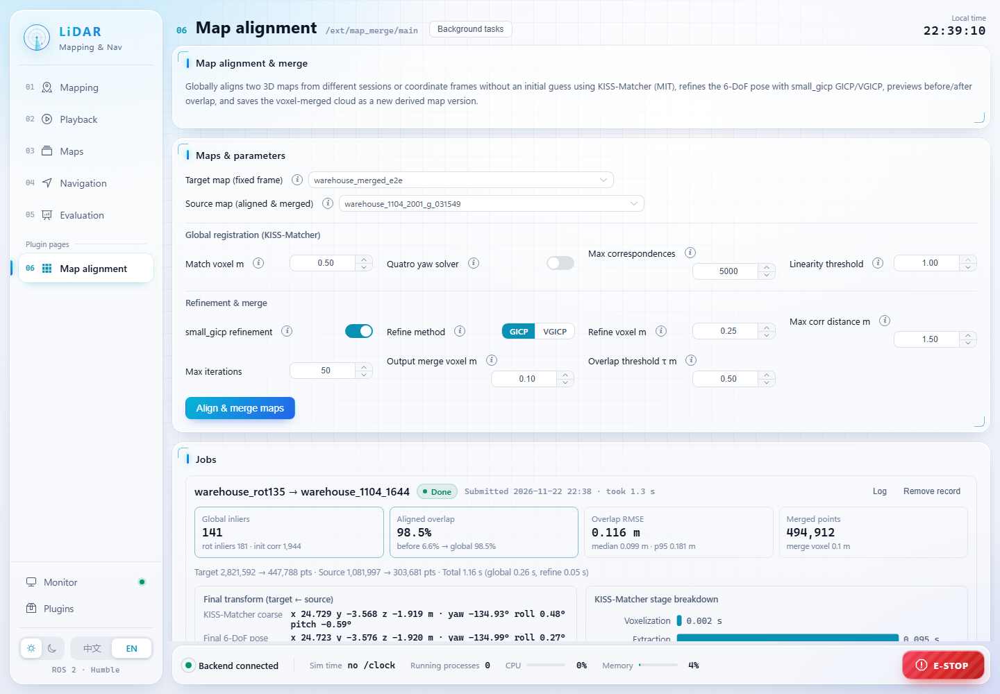
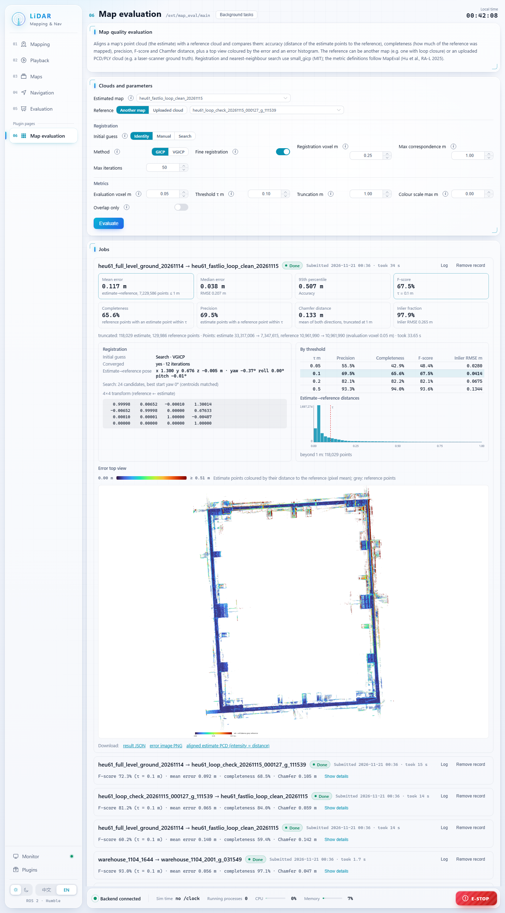
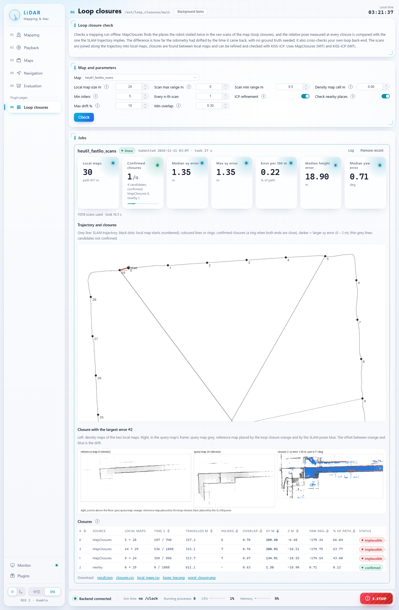

# SLAM and AutoNav Console

[English](README.md) | 中文

[](https://leonhart999.github.io/slam-autonav-console/)
[](https://leonhart999.github.io/slam-autonav-console/console/)
[](https://github.com/Leonhart999/slam-console-plugins)
[](https://docs.ros.org/en/humble/)
[](LICENSE)

面向 **LiDAR SLAM 建图、实车数据包回放、地图后处理、Nav2 自主导航、批量自动化实验与轨迹/地图质量评估** 的浏览器控制台，运行于 ROS 2 Humble 与 Gazebo Fortress。在同一个网页工作台里，即可从一个空仿真场景或录制的 rosbag2 数据包出发，完成建图、调参、地图清理/闭环、导航闭环测试以及可复现的 `evo` 评估报告。

本项目是哈尔滨工程大学本科毕业设计 *LiDAR-Based SLAM Mapping and Autonomous Navigation for Mobile Robots* 的配套软件。界面支持**中英文切换**、**浅色 / 深色 / 插件扩展主题**（内置护眼防蓝光暖色主题），并提供**统一插件机制与 GitHub 插件市场**。

- **[仓库建图在线演示](https://leonhart999.github.io/slam-autonav-console/)**：在浏览器中回放一段 230 m 的 FAST-LIO2 仿真仓库建图过程，实时查看 3D 点云与 APE 误差曲线。
- **[完整控制台只读预览](https://leonhart999.github.io/slam-autonav-console/console/)**：免安装浏览原版控制台各页面、已保存的 2D/3D 地图、导航实验、评估图表以及公开插件市场目录（只读，无需 ROS 2 后端）。

[](https://www.bilibili.com/video/BV1wm4v6GEQq)

*视频导览（2:19，[在 B 站观看](https://www.bilibili.com/video/BV1wm4v6GEQq) 或 [下载 MP4](https://github.com/Leonhart999/slam-autonav-console/releases/download/v0.1.0/slam-autonav-console_tour.mp4)，49 MB）：在办公室场景用 FAST-LIO2 建图并保存，在仓库场景执行三航点 Nav2 任务，并在系统监控与实验评估页查看结果（中英双语字幕）。*



## 目录

- [核心页面](#核心页面)
- [功能展示与实测示例](#功能展示与实测示例)
  - [1. 实时 3D 建图与批量 SLAM 对比实验](#1-实时-3d-建图与批量-slam-对比实验)
  - [2. 地图页一键离线平面回环优化](#2-地图页一键离线平面回环优化)
  - [3. 地图后处理工具插件（DUFOMap 与 Patchwork++）](#3-地图后处理工具插件dufomap-与-patchwork)
  - [4. 跨会话地图拼接、无真值回环诊断与 3D 地图评估](#4-跨会话地图拼接无真值回环诊断与-3d-地图评估)
- [插件生态（内置 + 市场统一上架）](#插件生态内置--市场统一上架)
- [典型使用流程](#典型使用流程)
- [工作原理](#工作原理)
- [快速开始](#快速开始)
- [可选组件与配置](#可选组件与配置)
- [仓库结构](#仓库结构)
- [局限](#局限)
- [第三方组件](#第三方组件)
- [许可证](#许可证)

## 核心页面

| 页面 | 主要能力 |
|---|---|
| **01 建图** | 启动内置仿真场景（`office`、`warehouse`、可选 `hkust_4f_west`）或自己上传的 SDF / ZIP 场景；运行 **FAST-LIO2**（标准、**仅激光**、**地面车辆约束**模式）或 **GLIM**；通过**参数**弹窗查看并覆盖分层 SLAM 参数；在 3D 视图中流畅观察体素地图增长；支持屏幕摇杆 / WASD 遥控或自动航点巡航；一键保存 3D + 2D 地图 |
| **02 数据回放** | 回放 rosbag2 数据包（整包或指定时间段，`0.5×–8×`）至 FAST-LIO2、GLIM 或 GLIM（仅激光）；通过网页内**传感器配置**自动探测话题、逐点时间字段/单位、IMU 加速度单位与外参；支持 `start_offset` 跳过启动抖动段；可开启**保存原始扫描**供后续回环优化、去动态与逐帧证据投影使用；浏览器内上传与回收站管理 |
| **03 地图管理** | 3D 点云与 2D 占据栅格并排预览；导入纯 3D `.pcd` 时默认自动投影生成可导航 2D 栅格；支持按点云或**逐帧证据（Scan evidence）**重投影栅格；支持在页面直接发起**回环优化**并预览结果后另存；支持画笔编辑栅格及回收站恢复 |
| **04 导航** | 载入任意地图，启动仿真与 Nav2（可选 **NavFn / Smac / Theta\*** 规划器 × **DWB / MPPI** 控制器变体，支持 **AMCL / 真值定位**切换）；在 2D 地图上点击设初始位姿与多航点目标；叠加全局/局部代价地图、调节仿真倍速、切换点云/实体场景；实车回放地图可绑定场景或由栅格自动生成仿真墙体场景 |
| **05 实验评估** | 区分**建图、导航、回放**三类运行记录；计算 `evo` ATE / RPE、单目标点导航指标、回放首尾闭合/高度漂移/参考里程计偏差与 SLAM 滞后；支持**左右分栏 / 上下排列**视图；内置**批量建图**与**批量导航**重复实验（统计均值 ± 标准差）、用户改参标记、同片段相对轨迹对比以及 CSV / PNG 导出 |
| **系统监控** | 展示控制台管理的进程组状态、话题实际/期望频率、TF 变换链、活跃节点列表以及进程退出原因 |
| **插件** | **已安装 / 插件市场**双标签管理：开关启停（重启生效）、清单驱动设置表单、插件独立 Python 虚拟环境与后台作业队列；支持从 [`Leonhart999/slam-console-plugins`](https://github.com/Leonhart999/slam-console-plugins) 在线安装/更新（SHA-256 校验）或上传本地 `.zip`；市场升级平滑覆盖内置副本而不产生冲突 |

2D 重投影、离线回环优化、`evo` 评估、相对轨迹对比与报告导出等耗时操作均接入页头**后台任务**抽屉，切换页面或刷新后仍可持续追踪进度、找回结果、重试或清理记录。

每次运行都会沉淀完整记录（`est.tum`、`gt.tum` / `ref.tum`、`slam_config`、滞后日志，或导航目标 CSV 与曲线图）；每张地图都以独立目录保存完整点云、Nav2 `map.yaml` / `map.pgm`、预览图和元数据。

## 功能展示与实测示例

### 1. 实时 3D 建图与批量 SLAM 对比实验

**建图**页由后端增量体素化并通过二进制 WebSocket 推送，大场景地图在浏览器里依然保持高帧率渲染。**实验评估**页内置批量重复实验框架，自动跑完 N 轮并汇总 `均值 ± 标准差`（例如 `office` N = 5 FAST-LIO2 ATE `0.0305 ± 0.0012 m`，`warehouse` N = 3 ATE `0.0346 ± 0.0011 m`，调优后 GLIM 仓库 ATE `0.0149 m`）。

<p>
  
  
</p>

### 2. 地图页一键离线平面回环优化

对于回放时开启**保存原始扫描**建出的地图，在**地图管理**页点击**回环优化**即可后台运行离线平面位姿图后端（`GTSAM` + `small_gicp`），展示回环候选核验表与重访处墙面前后对比图，确认后另存为派生地图版本而不破坏原图。下图为一段 611 m 实车走廊闭环实测：终点水平漂移 `2.52 m`（航向 `-1.05°`）被有效闭合，重访处墙面中位误差从 `42.2 cm` 降至 `6.4 cm`（90% 分位 `243.3 → 15.5 cm`）。



### 3. 地图后处理工具插件（DUFOMap 与 Patchwork++）

内置工具插件可在网页中直接清理实车地图，并通过 `POST /api/maps/{name}/derive` 非破坏性地另存为新版本地图：

- **动态物体去除（`dynamic_removal`）**：利用 DUFOMap 结合逐帧原始扫描空闲空间，自动剔除行人、车辆留下的“鬼影”点（下左：M3DGR `Occlusion01` 共 `1,422` 帧耗时 `2.9 s`，标出并剔除 `0.48%` 动态残留点）。
- **地面分割（`ground_seg`）**：基于 Patchwork++ 分离局部地面与障碍物，按点云相对当地地面的高度重建 2D 栅格，修复倾斜或带高度漂移的地图（下右：M3DGR 倾斜点云图 `2.3 s` 重建出清晰可导航的房间栅格）。

<p>
  
  
</p>

### 4. 跨会话地图拼接、无真值回环诊断与 3D 地图评估

在 **插件 → 插件市场** 一键安装并自动构建独立 Python 虚拟环境：

- **地图拼接配准（`map_merge`，KISS-Matcher + `small_gicp`）**：无需初始位姿即可全局配准两张不同会话/坐标系的 3D 地图，再做 GICP/VGICP 精配准并导出融合地图（下图：`1.3 s` 内找回 `135°` 旋转 + `[24.7, -3.6, -1.9] m` 平移的仓库错位，重叠率 `6.6% → 98.5%`，RMSE `0.116 m`）。
- **地图质量评估（`map_eval`，`small_gicp` / MapEval）** 与 **回环检查（`loop_closures`，MapClosures + KISS-ICP）**：与参考点云对比精度/完整度/F 值/倒角距离并绘出误差热力图；或在无真值条件下直接量测实车回环处的平面、高度和航向漂移。



<details>
<summary>展开更多插件实测截图：地图质量评估（<code>map_eval</code>）与回环检查（<code>loop_closures</code>）</summary>

<p>
  
  
</p>

</details>

## 插件生态（内置 + 市场统一上架）

所有插件基于统一的 **Plugin Interface v1**（`plugin.yaml`、`/api/ext/<id>`、`window.RobotConsole` SDK、独立 Python venv、默认停用信任模型）。核心插件既随控制台预装保证离线可用，又同步上架到公开市场索引 [`Leonhart999/slam-console-plugins`](https://github.com/Leonhart999/slam-console-plugins)，在一个目录中统一浏览，且支持直接在线升级覆盖内置版：

| 插件 | 分发方式 | 核心依赖 | 功能说明 |
|---|---|---|---|
| **`ai_assistant`** AI 助手（`0.4.0`） | 内置 + 市场 | OpenAI 兼容 / Anthropic 接口、内置 CPA OAuth 引擎 | 可拖拽调宽的页头聊天抽屉，支持 SQLite 历史对话检索/置顶/导出、Token 用量与费用估算图表、OAuth 订阅账号登录、只读查询控制台数据及带审批的实验/评估执行工具 |
| **`bag_convert`** 数据包转换 | 内置 + 市场 | [rosbags](https://gitlab.com/ternaris/rosbags)（Apache-2.0） | 将 ROS 1 `.bag` 转为 ROS 2（`sqlite3` / `MCAP`），支持话题筛选与 Livox `CustomMsg` → `PointCloud2` 转换 |
| **`dynamic_removal`** 动态物体去除 | 内置 + 市场 | [DUFOMap](https://github.com/KTH-RPL/dufomap)（BSD-3） | 利用原始扫描空闲空间剔除行人/车辆残留鬼影点，并派生新版本地图 |
| **`ground_seg`** 地面分割 | 内置 + 市场 | [Patchwork++](https://github.com/url-kaist/patchwork-plusplus)（BSD-2） | 分离局部地面与障碍物点云，按相对地面高度重建 Nav2 2D 占据栅格 |
| **`eye_care_ui`** 护眼防蓝光 UI | 内置 + 市场 | 插件主题扩展 API v1 | 提供暖琥珀低蓝光外观主题、页头快捷切换开关以及实时蓝光过滤强度 / 色温暖度 / 对比度调节 |
| **`map_eval`** 地图质量评估 | 市场 | [small_gicp](https://github.com/koide3/small_gicp)（MIT） | 将估计地图与参考点云（另一张地图或 PCD/PLY）配准，计算 MapEval 精度、完整度、准确率、F 值、倒角距离及误差直方图与俯视图 |
| **`loop_closures`** 回环检查 | 市场 | [MapClosures](https://github.com/PRBonn/MapClosures) + [KISS-ICP](https://github.com/PRBonn/kiss-icp)（MIT） | 在带原始扫描的地图中自动检出重访回环，无真值条件下量化里程计平面/高度/航向漂移 |
| **`map_merge`** 地图拼接配准 | 市场 | [KISS-Matcher](https://github.com/MIT-SPARK/KISS-Matcher) + [small_gicp](https://github.com/koide3/small_gicp)（MIT） | 无需初始位姿全局 6-DoF 配准两张 3D 地图，GICP/VGICP 精配准、重叠预览并导出体素合并地图 |

想要编写自己的插件？请参考 [robot_console/docs/plugins.md](robot_console/docs/plugins.md)、[robot_console/docs/plugin-guidelines.md](robot_console/docs/plugin-guidelines.md)、示例插件 `robot_console/examples/plugins/hello_console`，以及插件市场仓库的 [`CONTRIBUTING.md`](https://github.com/Leonhart999/slam-console-plugins/blob/main/CONTRIBUTING.md)。

## 典型使用流程

<details>
<summary><strong>流程 A：仿真建图 → 自主导航 → 批量基准实验</strong></summary>

1. 进入**建图**页，选择 `office` 或 `warehouse` 场景，启动**仿真**与 **FAST-LIO2**（或 **GLIM**），通过**自动航点**或 WASD/摇杆完成一圈巡航。
2. 点击**保存地图**，自动归档 3D 点云、2D Nav2 栅格、轨迹与元数据。
3. 进入**导航**页，选择刚才的地图以及规划/控制变体（如 `navfn_dwb`、`smac_mppi`）与定位模式（`AMCL` 或 `真值定位`），启动仿真和导航并在 2D 栅格上指定目标点。
4. 进入**实验评估**页查看 ATE/RPE 和 AMCL 误差曲线，或直接发起**批量建图 / 批量导航**重复实验并导出 CSV 与 PNG 图表。

</details>

<details>
<summary><strong>流程 B：实车数据集 → 去噪与回环闭环 → 虚拟场景导航验证</strong></summary>

1. 若原始数据是 ROS 1 `.bag`（含 Livox `CustomMsg`），先在**插件**页启用**数据包转换**插件转为 ROS 2 数据包；逐帧 PCD 可用 `robot_console/tools/pcd_frames_to_bag.py` 转换。
2. 进入**数据回放**页选择数据包，点开**传感器配置**自动探测话题、逐点时间字段、IMU 加速度单位与外参；勾选**保存原始扫描**（轮式小车建议同时开启**地面车辆约束**），以 `1×–4×` 回放建图。
3. 保存地图后进入**地图管理**页：运行**回环优化**闭合平面漂移，或通过**动态物体去除**与**地面分割**插件清理行人和倾斜地面并另存派生版本。
4. 在**导航**页打开清理后的地图，由其 2D 栅格一键生成仿真墙体场景，即可对实车环境布局进行 Nav2 闭环导航验证。

</details>

## 工作原理

```text
浏览器（Vue 3、Three.js、ECharts）  <-- HTTP + WebSocket，127.0.0.1:8000 -->  robot_console（rclpy + FastAPI）
                                                                                 |  ROS 2 话题、服务、动作
                                                     Gazebo Fortress  /  FAST-LIO2 或 GLIM  /  Nav2 + AMCL  /  evo
                                                                                 |  ctx.api / ctx.jobs / 独立 venv
                                                                          内置与市场插件（Interface v1）
```

- **白名单进程组管理**：后端按 `robot_console/config/stacks.yaml` 白名单将仿真、SLAM、回放和导航作为独立进程组启停；前端只能请求预定义名称，无法传入任意命令行。
- **分层 SLAM 参数合成**：每次运行从 `robot_console/config/slam/` 按 `base → input → derived → options → console → user` 合成生效配置，并完整写入 `run.json`，便于事后追溯与跨实验对比。
- **高帧率 3D 网页流**：点云在后端增量体素化并以紧凑二进制差分推送，解决 WSLg 下 `rviz2` 累积地图掉到 ~3 fps 的问题。
- **安全联锁**：遥控超过 `0.5 s` 无指令或网页断连自动停车；**急停（E-STOP）**下发零速度、取消 Nav2 目标并终止所有驱动小车的进程。

## 快速开始

环境要求：Ubuntu 22.04 `x86_64`（原生系统或 Windows 10/11 WSL2），具备 `sudo` 权限的普通用户，建议 16 GB 内存，约 10 GB 可用磁盘空间。

```bash
mkdir -p ~/ros2_ws/src && cd ~/ros2_ws/src
git clone https://github.com/Leonhart999/slam-autonav-console.git
bash slam-autonav-console/robot_console/install/install.sh          # 中国大陆可加 --cn 使用国内镜像
bash slam-autonav-console/robot_console/install/start_console.sh    # 启动控制台并打开 http://localhost:8000
```

安装脚本会自动部署 ROS 2 Humble、Gazebo Fortress、Nav2、Livox-SDK2、FAST-LIO2（固定版本加补丁）、控制台与 evo Python 虚拟环境及网页前端，并在末尾执行自检；已完成步骤会自动跳过，网络中断后重跑即可续装。详细选项和离线安装说明见 [robot_console/README.md](robot_console/README.md)（英文）。

也支持 Docker 一键构建运行：

```bash
docker compose build          # 中国大陆构建时可加 CN=1
docker compose up -d
```

详见 [docker/README.md](docker/README.md)（英文；已在 WSL2 + Docker Engine 下验证，导航页暂未在容器内测试）。

## 可选组件与配置

- **GLIM**（带回环的因子图 SLAM）：从作者 PPA 安装 `ros-humble-glim-ros`（<https://koide3.github.io/glim/installation.html>）。针对仿真 16 线激光雷达的基础配置在 `sim_robot/config/glim`，控制台通过 `robot_console/config/slam/glim.yaml` 分层覆盖。
- **港科大 4 楼西侧长走廊场景**（由 [SLABIM](https://github.com/HKUST-Aerial-Robotics/SLABIM) BIM 生成）：只需下载 `BIM.zip`（96 MB）。原 SharePoint 链接已失效，请从 Hugging Face 获取（国内镜像：`https://hf-mirror.com/datasets/BobH62/SLABIM/resolve/main/BIM.zip`）：

  ```bash
  wget https://huggingface.co/datasets/BobH62/SLABIM/resolve/main/BIM.zip
  python3 -m zipfile -e BIM.zip SLABIM        # 得到 SLABIM/BIM/4F/mesh/*.ply
  bash sim_robot/tools/make_hkust_models.sh SLABIM
  colcon build --packages-select sim_robot
  ```

- **离线平面回环后端环境**：如需在**地图管理**页使用**回环优化**（或命令行 `fastlio_loop_record`、`fastlio_loop`、`fastlio_loop_export`），请将 `robot_console/install/requirements-loop.txt` 安装至独立虚拟环境（默认 `~/venvs/loop`），避免与系统 GLIM / GTSAM 冲突。详见 [robot_console/docs/fastlio-loop-backend.md](robot_console/docs/fastlio-loop-backend.md)（英文）。
- **本机配置**：覆盖项写在 `~/.config/robot_console/console.yaml`（示例见 `robot_console/config/user_console.example.yaml`）。地图、运行记录、日志、数据包、传感器配置、插件数据/环境及导出文件默认存放在 `~/robot_console_data`。

## 仓库结构

| 目录 | ROS 2 包 | 内容 |
|---|---|---|
| `robot_console/` | `robot_console` | 控制台后端（FastAPI + rclpy）、前端（`web/`）、插件宿主 + 市场 + 内置插件（`plugins/`）、SLAM 分层配置规格、离线回环后端、安装脚本与测试 |
| `sim_robot/` | `sim_robot` | Gazebo 场景、差速小车（16 线激光雷达、IMU、真值）、点云适配、航点驱动、FAST-LIO2 / GLIM 配置 |
| `lidar_nav/` | `lidar_nav` | Nav2 启动文件与规划/控制参数变体、真值定位节点、3D → 2D 栅格投影、导航测试脚本 |
| `docker/` | — | Dockerfile、容器入口、容器配置与离线预取包指南 |

## 局限

- **仿真优先闭环**：导航默认在 Gazebo 中闭环运行，接真机需另行编写硬件进程与话题配置；实车数据可在**数据回放**页建图（`sqlite3` 存储；MCAP 需安装 `ros-humble-rosbag2-storage-mcap`），并由地图栅格生成仿真墙体场景进行导航测试。
- **传感器配置覆盖范围**：网页新建的传感器配置当前作用于 FAST-LIO2 与带 IMU 的 GLIM，`GLIM（仅激光）`暂不走传感器适配器；对于扫描结束时刻打时间戳、逐点偏移为负的雷达（如部分 Velodyne 包），探测会给出提醒，适配器当前会将负偏移截为 `0`。
- **平面回环后端假设**：假设大致水平的单层地面环境，且要求建图时已勾选保存原始扫描。
- **其他**：暂不支持独立导入离线轨迹；仅在 Ubuntu 22.04 + ROS 2 Humble（`x86_64`）上验证；使用 GLIM 保存地图会结束当次 GLIM 运行（因 GLIM 在退出时写出优化地图）。

## 第三方组件

| 组件 | 许可证 | 获取方式 |
|---|---|---|
| [FAST_LIO](https://github.com/hku-mars/FAST_LIO)、ikd-Tree | GPL-2.0 | 安装脚本下载；`robot_console/install/patches/fast_lio-thesis.patch` 将点云订阅改为 reliable QoS，并增加仅激光模式、地面车辆约束、ring 越界检查与更大 IMU 队列 |
| Livox-SDK2、livox_ros_driver2 | MIT | 安装脚本下载 |
| 仓库、货架、托盘和推车模型（Gazebo Fuel；OpenRobotics、MovAi） | CC BY-NC 4.0 / CC BY-NC-ND 4.0 | 由 `sim_robot/tools/fetch_fuel_models.sh` 下载；仅限非商业用途。在线演示仅渲染建出的点云，不包含模型本身 |
| 港科大 4 楼建筑模型（SLABIM，Huang 等，ICRA 2025） | 数据集未注明 | 由你自行下载的 SLABIM 本地生成，仓库不包含 |
| [GLIM](https://github.com/koide3/glim) | MIT | 可选，从作者 PPA 安装 |
| [evo](https://github.com/MichaelGrupp/evo) | GPL-3.0 | 安装脚本装入独立虚拟环境 |
| 内置与市场插件上游库（`rosbags`、`Patchwork++`、`DUFOMap`、`small_gicp`、`MapClosures`、`KISS-ICP`、`KISS-Matcher`） | Apache-2.0 / BSD-2 / BSD-3 / MIT | 在**插件**页按需安装进各自独立的 Python 虚拟环境 |

## 许可证

本仓库代码基于 MIT 许可证发布（见 [LICENSE](LICENSE)）。
